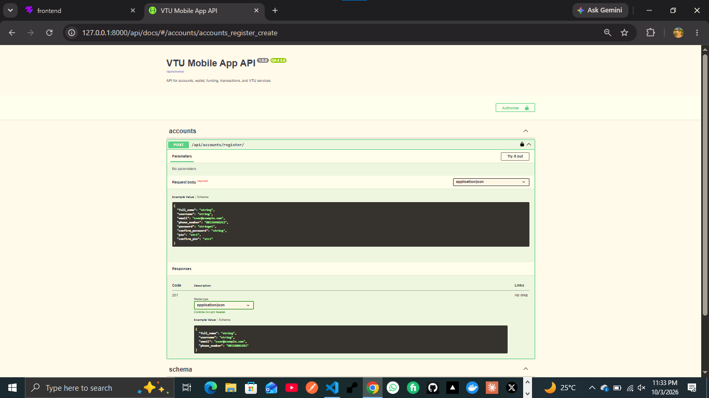
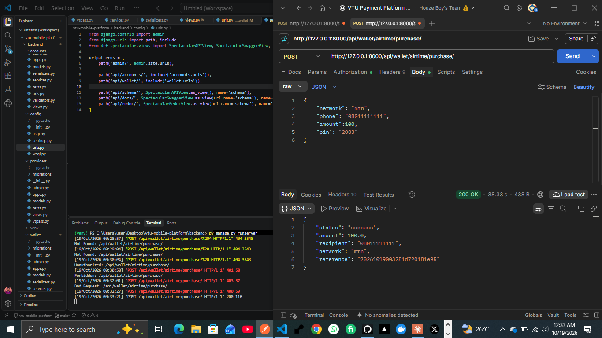
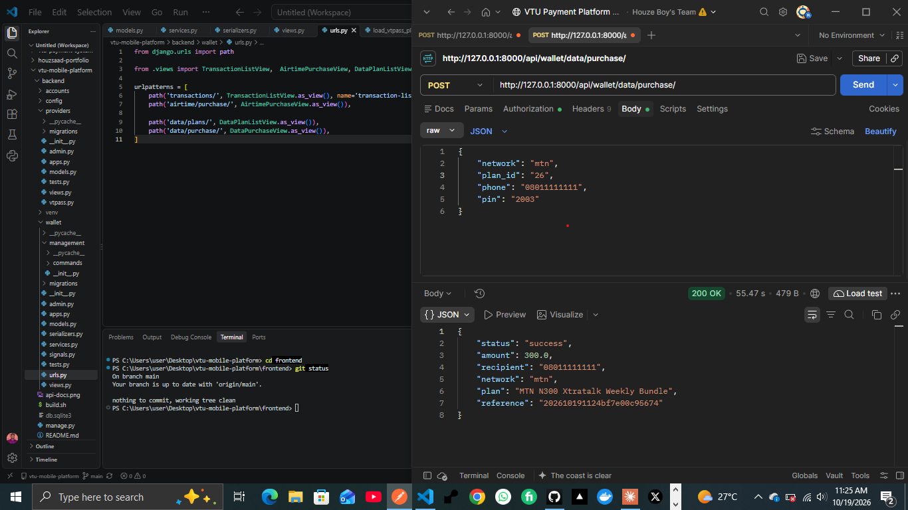

# VTU App — Backend

A VTU (airtime and data) platform API built with Django and Django REST Framework. Users fund a wallet by bank transfer and buy airtime and data with a transaction PIN. Admins manage plans, prices, announcements and pending transactions from the Django admin.

The React frontend (an installable PWA) lives in `/frontend` and talks to this API.

## Features

**Accounts**
- Register, login (username + password, JWT), logout, profile
- Change password and change transaction PIN (the new value cannot match the current one)
- Forgot password: one-time code by email, 10-minute expiry, 5 attempts, single use
- Transaction PIN: exactly 4 digits, stored hashed, separate from the login password

**Wallet and purchases**
- One wallet per user, created automatically on registration
- Airtime and data purchase, with the PIN checked on every purchase
- Data plans loaded from the provider, grouped by network and plan type
- Selling price and cost price stored per plan, so profit is visible in the admin
- Transaction history with Successful / Pending / Failed / Refunded states
- Every money movement is written to a ledger (`WalletEntry`)

**Wallet funding (bank transfer)**
- The user asks to fund an amount and receives a temporary bank account (Paystack Pay with Transfer)
- A signed Paystack webhook credits the wallet once the transfer arrives
- Paystack's transfer fee is absorbed, so users fund for free

**Admin tools**
- Settle a pending transaction: mark success, or mark failed and refund
- Bulk activate or deactivate data plans, and edit selling prices
- Read-only ledger and funding-request views
- Announcements: banners that appear on the app's dashboard (service issues, news)

## How money is kept safe

These rules are built into the code and should not be bypassed:

- A wallet is credited only from a verified payment webhook (signature checked), never from anything the browser sends.
- The same payment reference can never credit twice.
- A payment with the wrong amount, or one that arrives after the account expired, is not credited automatically. It is held for manual review.
- Purchases lock the wallet row, debit first, and never hold a database lock while calling the provider.
- Only an explicit provider success counts as success, and only an explicit failure is refunded. Anything unclear stays **pending** for manual settlement.
- A failed purchase is refunded exactly once (one refund entry per transaction).
- Transaction fields are read-only in the admin. A status changes only through the settle actions, which move the money correctly.

## Tech stack

- Django 5.2, Django REST Framework, Simple JWT
- PostgreSQL (Neon in production)
- drf-spectacular for API docs
- Providers: DodoData (default) and VTPass, selected with one setting
- Payments: Paystack (Pay with Transfer)
- Email: Resend (needs a verified domain for real delivery)
- Deployed on Render (API) and Vercel (frontend)

## Project structure

```text
vtu-mobile-platform/
├── backend/
│   ├── config/          # Django settings, root URLs
│   ├── accounts/        # Registration, auth, profile, password reset
│   ├── wallet/          # Wallet, transactions, ledger, data plans, purchases
│   ├── funding/         # Paystack bank-transfer funding and webhook
│   ├── announcements/   # Admin-managed banners
│   ├── providers/       # dododata.py, vtpass.py (buy_airtime, buy_data, requery)
│   └── manage.py
└── frontend/            # React + Vite PWA
```

## Local setup

```bash
cd backend
python -m venv venv
venv\Scripts\activate          # Windows
source venv/bin/activate       # macOS/Linux

pip install -r requirements.txt
python manage.py migrate
python manage.py createsuperuser
python manage.py runserver
```

The API runs at `http://127.0.0.1:8000/`.

## Environment variables

Create a `.env` file in `backend/` (never commit it). Names and purpose only:

| Variable | Purpose |
|---|---|
| `SECRET_KEY` | Django secret key |
| `DEBUG` | `True` locally, `False` in production |
| `DATABASE_URL` | PostgreSQL connection string |
| `ALLOWED_HOSTS` | Allowed API hostnames |
| `CORS_ALLOWED_ORIGINS` | https://vtu-mobile-platform.vercel.app |
| `VTU_PROVIDER` | Active provider: `dododata` or `vtpass` |
| `DODODATA_BASE_URL`, `DODODATA_API_KEY` | DodoData access |
| `DODODATA_PRICE_FIELD` | Which provider price counts as cost (default `priceForNormalUser`) |
| `VTPASS_*` | VTPass access (if used) |
| `PAYSTACK_SECRET_KEY` | Paystack secret key (test or live) |
| `APP_NAME` | VTU App |
| `EMAIL_BACKEND`, `DEFAULT_FROM_EMAIL` | Email sending (console backend by default) |
| `RESEND_API_KEY` | Resend key, once a domain is verified |
| `ALLOW_TEST_FUNDING` | Leave unset in production |

The frontend needs `VITE_API_URL` (the API address including `/api`), and optionally `VITE_APP_NAME` and `VITE_SUPPORT_WHATSAPP`.

## First-run setup (new deployment)

1. Deploy the API and apply migrations (`python manage.py migrate`).
2. Create the admin user (`python manage.py createsuperuser`).
3. Set `VTU_PROVIDER` and the provider keys.
4. Load the provider's plans:
   ```bash
   python manage.py load_dododata_plans
   ```
   New plans start **inactive**, and existing plans keep their price and active state.
5. In the admin under **Data plans**: filter by network, search, then select and **Activate** the plans you want to sell. Edit the selling price of each (the cost price is shown next to it).
6. In the Paystack dashboard, set the webhook URL to `https://<your-api>/api/funding/webhook/`.
7. Point the frontend's `VITE_API_URL` at the API and deploy it.

## Admin guide

**A transaction is pending.** Check the provider's dashboard for that phone number and amount, then open **Transactions**, filter by status `pending`, tick the row and choose:
- **Mark selected PENDING as SUCCESS** if it was delivered
- **Mark selected PENDING as FAILED and refund** if it was not

Never refund without checking the provider first. Statuses cannot be edited by hand.

**A funding request shows "review".** The money arrived but did not match (wrong amount or late). Check the amount in the Paystack dashboard before using **Credit selected REVIEW requests**.

**Post an announcement.** Open **Announcements → Add**, write a title and message, pick a level (Info, Warning or Good news), and save. Untick **Is active** or set an expiry time to remove it.

## API documentation

With the server running:

```
Swagger UI: /api/docs/
Redoc:      /api/redoc/
Raw schema: /api/schema/
```

<p align="center">
    
</p>

### Buy airtime (Postman)
<p align="center">
    
</p>

### Buy data (Postman)
<p align="center">
    
</p>

## Account rules

- Phone number: 11 digits, numbers only, must start with 090, 091, 080, 081 or 070.
- Password: at least 8 characters, with a lowercase letter, an uppercase letter, a number and a special character.
- Transaction PIN: exactly 4 digits, numeric only, stored hashed.
- Full name: letters, spaces and apostrophes only (for example Sa'ad).
- Username: letters and numbers only, unique.

## Known limitations

- Reset emails reach real users only after a domain is verified with the email provider. Until then the code is printed in the server logs.
- Login and registration have no rate limit yet (password reset does).
- The provider offers no way to check a transaction's status later, so unclear results are settled by hand in the admin.
- Data plans for a network exist only if the provider sells them.
- Push notifications and a forgot-PIN flow are not built.

## Author

**Huzaifa Sa'ad** ([@Houzsaad](https://github.com/Houzsaad))
