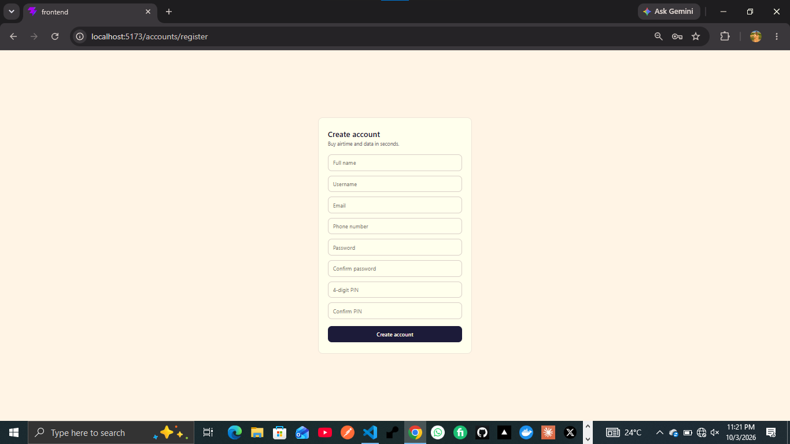
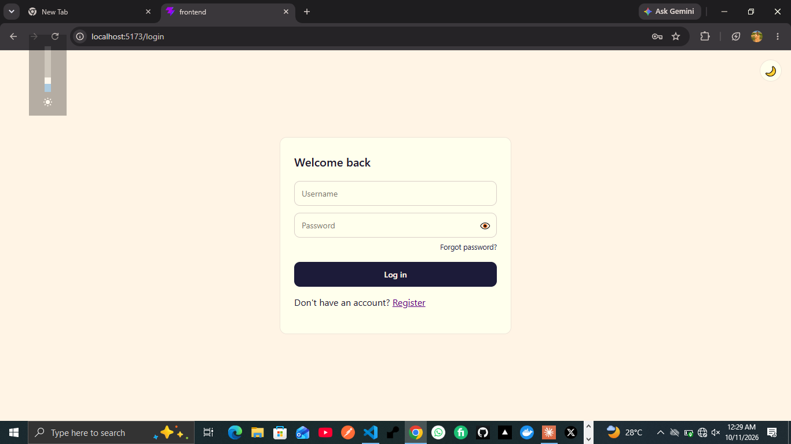
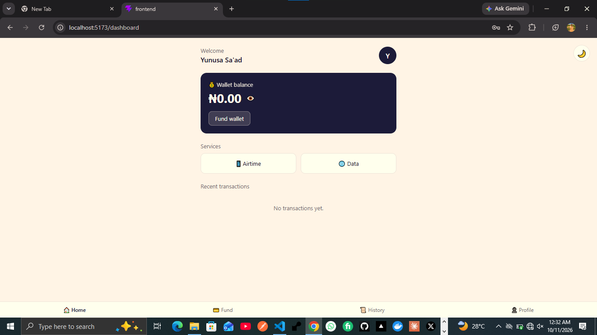
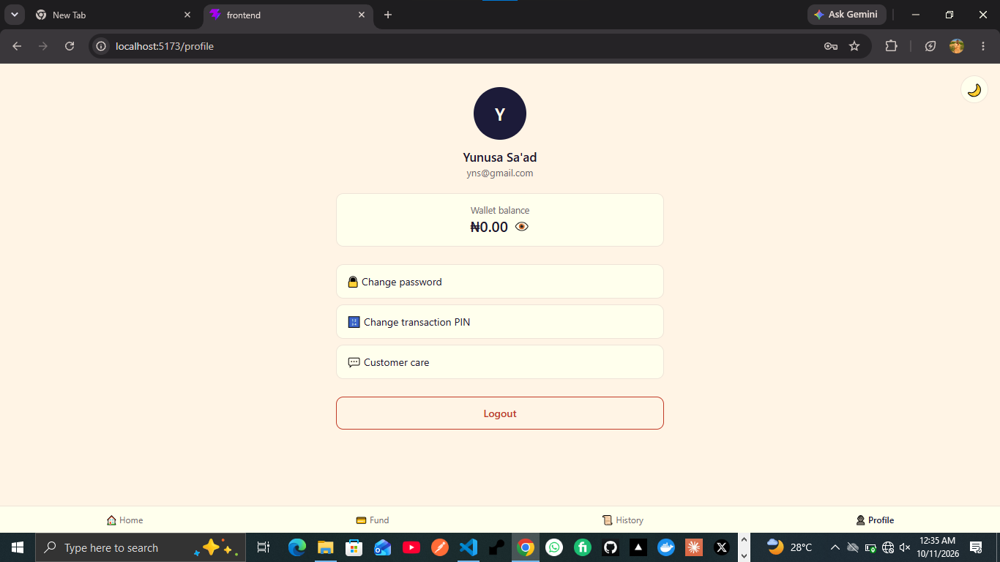
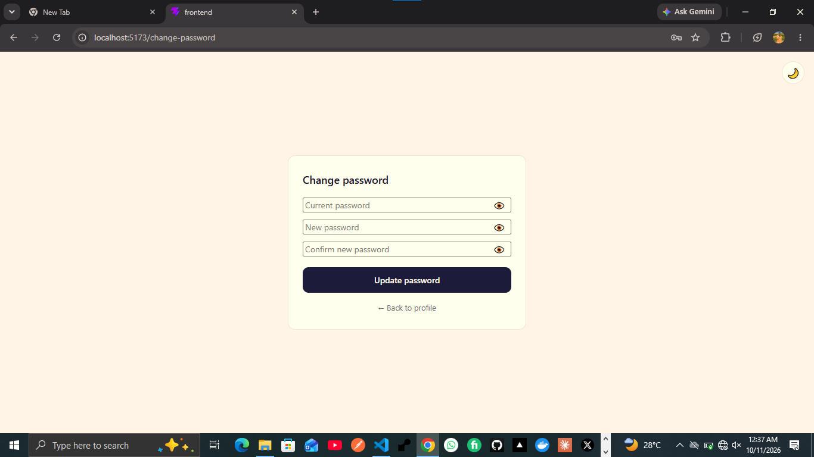
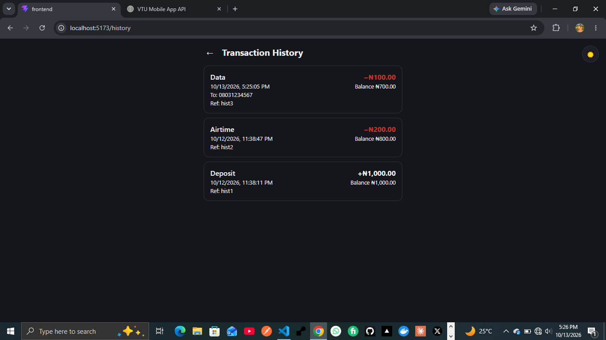

# VTU App — Frontend

React frontend for the VTU app, built with Vite. It is an installable PWA that talks to the Django REST API in `../backend`.

## Tech stack

- **React** (Vite)
- **react-router-dom** for routing
- **fetch()** for API calls (no axios)
- **vite-plugin-pwa** for the manifest and service worker
- Plain CSS with shared design tokens (`src/index.css`)

## Features

- [x] **Register**: full name, username, email, phone number, password, confirm password, 4-digit PIN and confirm PIN. Field-level errors from the API are shown under the form. Redirects to login on success.
- [x] **Login** with show/hide password and a loading state.
- [x] **Forgot password**: the user enters their email, receives a 6-digit code, then sets a new password. The page shows a clear message if too many attempts were made. Real email delivery needs a verified domain on the backend.
- [x] **Dashboard**: wallet balance with hide/show, service shortcuts, the three most recent transactions and a "View all" link.
- [x] **Fund wallet**: the user enters an amount and receives a temporary bank account with a countdown. The page checks every few seconds and shows when the wallet is credited.
- [x] **Buy airtime**: choose a network, enter the phone number (or pick it from contacts on supported phones), the amount and the transaction PIN.
- [x] **Buy data**: choose a network, then a plan type (SME, Corporate, Gifting and so on), then a plan, then the phone number (optional contacts picker). A confirmation screen shows the details before the user enters the PIN.
- [x] **Transaction history**: service type, recipient, amount, balance after, and a status badge (Successful, Pending, Failed or Refunded). Refunded and failed amounts are shown struck through, so they do not look like a debit.
- [x] **Profile**: account details, wallet balance (follows the dashboard's hide setting) and a customer care link.
- [x] **Change password** and **change transaction PIN**: the new value cannot match the current one.
- [x] **Light/dark mode**: sun/moon toggle, remembered between visits.
- [x] **PWA**: installable (manifest and service worker), works like a mobile app, and protected routes redirect to login.
- [x] **Announcement banner**: shows messages the admin posts (service issues, news). The user can dismiss one, and it stays hidden on that device.

How a purchase works from the user's side: the app asks the backend to buy, and the backend checks the PIN, locks and debits the wallet, then calls the provider. A failed purchase is refunded by the backend. An unclear result shows as **Pending** in History until the admin settles it.

## Project structure

```text
frontend/
├── src/
│   ├── api.jsx                   # fetch helpers (apiGet / apiPost)
│   ├── config.js                 # app name and support number from env
│   ├── utils/
│   │   └── phone.js              # phone number cleanup and contacts picker
│   ├── components/
│   │   ├── Register.jsx / .css
│   │   ├── Login.jsx / .css
│   │   ├── ForgotPassword.jsx
│   │   ├── Dashboard.jsx / .css
│   │   ├── Fund.jsx / .css
│   │   ├── Airtime.jsx
│   │   ├── Data.jsx / .css
│   │   ├── History.jsx / .css
│   │   ├── RecentTransactions.jsx / .css
│   │   ├── TransactionRow.jsx
│   │   ├── Profile.jsx / .css
│   │   ├── ChangePassword.jsx / .css
│   │   ├── ChangePIN.jsx
│   │   ├── AnnouncementBanner.jsx / .css
│   │   ├── PasswordInput.jsx
│   │   └── ThemeToggle.jsx / .css
│   ├── App.jsx                   # routes
│   ├── main.jsx
│   └── index.css                 # global styles and design tokens
├── public/                       # PWA icons
├── index.html
└── package.json
```

## Local setup

```bash
cd frontend
npm install
```

Create `frontend/.env` (never commit it):

```text
VITE_API_URL=http://127.0.0.1:8000/api
VITE_APP_NAME=Your App Name
VITE_SUPPORT_WHATSAPP=234XXXXXXXXXX
```

Then run:

```bash
npm run dev
```

The app runs at `http://localhost:5173`. Start the backend first (see `../backend/README.md`). Vite reads `.env` only at startup, so restart `npm run dev` after changing it.

## Environment variables

| Variable | Purpose |
|---|---|
| `VITE_API_URL` | The API address **including `/api`**, with no trailing slash |
| `VITE_APP_NAME` | The app's display name |
| `VITE_SUPPORT_WHATSAPP` | Customer care WhatsApp number, in international format without `+` |

On Vercel, set the same variables under Project → Settings → Environment Variables and redeploy.

## Deployment (Vercel)

- Framework preset: Vite. Build command `npm run build`, output directory `dist`.
- `vercel.json` rewrites every path to `index.html`, so refreshing a page such as `/dashboard` does not return a 404.
- The backend's `CORS_ALLOWED_ORIGINS` must contain this site's exact address.

## Local storage

The app keeps only light, per-device settings in the browser:

- the JWT tokens used to stay logged in
- `balance_hidden`: whether the wallet balance is hidden (shared by the dashboard and profile)
- `theme`: light or dark mode
- `dismissed_announcements`: announcements the user closed

Money and account data always come from the backend, never from local storage.

## Design system

Shared tokens live in `src/index.css` (colors, radius, font) and are reused across screens. Dark mode works by switching a `data-theme` attribute, which swaps the token values.

## Screenshots

### Registration
<p align="center"></p>

### Login
<p align="center"></p>

### Dashboard
<p align="center"></p>

### Profile
<p align="center"></p>

### Change password
<p align="center"></p>

### Transaction history
<p align="center"></p>

## Known limitations

- The contacts picker works only on browsers that support it (Chrome on Android, over HTTPS). Elsewhere the user types the number.
- Push notifications are not built.
- The history page shows a new status only after a reload.

## Author

**Huzaifa Sa'ad** ([@Houzsaad](https://github.com/Houzsaad))
